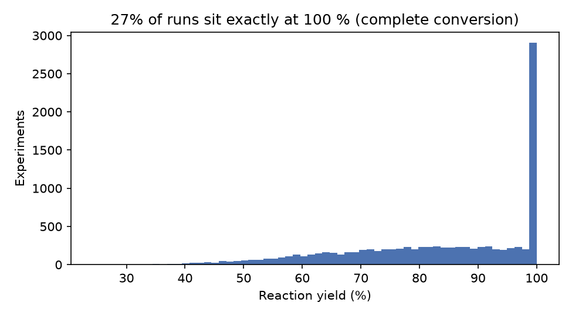
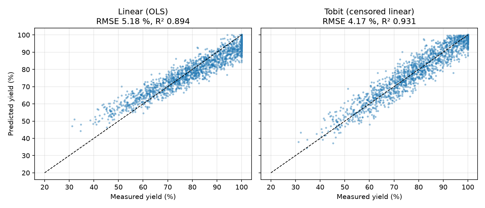
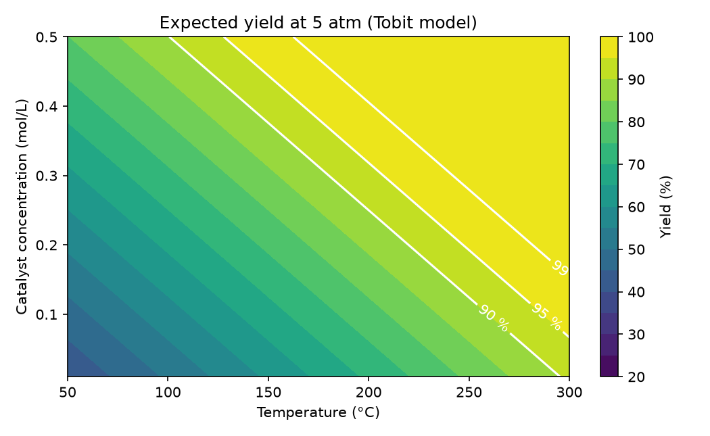

# Chemical Reaction Yield Predictor

Predicts reaction yield (%) from **temperature, pressure and catalyst concentration**, and finds the mildest operating conditions that reach a target yield. Comes with a Streamlit app, a reproducible training and evaluation pipeline, and tests.

The main finding: **27 % of the experiments sit exactly at 100 % yield.** These are runs that reached complete conversion, so 100 % is a ceiling (a censored value), not an exact measurement. A **censored (Tobit) regression** that models the ceiling explicitly beats every black-box model tried. It is also the only model whose coefficients mean something physically.



## Results

5-fold cross-validation on 80 % of the data, then one untouched 20 % hold-out set (`python train.py` regenerates this table in `reports/metrics.md`):

| Model | CV RMSE (5-fold) | Test RMSE | Test MAE | Test R² |
| --- | --- | --- | --- | --- |
| Linear (OLS) | 5.271 ± 0.073 | 5.180 | 3.858 | 0.8936 |
| **Tobit (censored linear)** | **4.180 ± 0.097** | **4.168** | **2.965** | **0.9311** |
| KNN (k=20) | 4.352 ± 0.067 | 4.295 | 3.064 | 0.9268 |
| SVR (RBF) | 4.223 ± 0.087 | 4.195 | 2.979 | 0.9302 |
| Neural net (MLP 128-64) | 4.197 ± 0.090 | 4.173 | 2.987 | 0.9309 |
| Gradient boosting | 4.414 ± 0.103 | 4.353 | 3.122 | 0.9249 |

- The **Tobit model has 5 parameters** and matches or beats an MLP with about 9,000 weights. It cuts RMSE by **21 %** compared with ordinary linear regression.
- **The noise floor:** run-to-run noise in the data is σ ≈ 5.0 %. If the Tobit model were exactly right, the lowest achievable RMSE would be about **4.20 %**, and the best models already reach it. More complex models cannot do better on this data; what remains is measurement noise, not missed structure.
- **Plain least squares is biased.** It treats every 100 % row as an exact value, which flattens its slopes: it over-predicts low yields and under-predicts high ones.



### The fitted model in physical units

```
yield* = 14.73 + 0.201·T[°C] + 3.02·P[atm] + 79.9·C[mol/L]  + noise (σ = 5.0 %)
observed yield = min(yield*, 100)
```

Each +10 °C adds about 2 % yield, each +1 atm about 3 %, and each +0.1 mol/L of catalyst about 8 %. The model also gives the **probability of complete conversion**, P(yield* ≥ 100), for any operating point.

## Operating window

For a target yield, the app finds the lowest temperature (the energy cost) needed at each catalyst loading. Equivalently, it finds how much catalyst can be saved by running hotter. Example at 5 atm:



## The app

```bash
python -m venv .venv && source .venv/bin/activate
pip install -r requirements.txt
python train.py          # trains all models, writes models/ and reports/ (~1 min)
streamlit run app.py
```

Tabs:
- **Prediction:** expected yield, 90 % range for a single run, and probability of complete conversion. Warns when inputs fall outside the training range.
- **Sensitivity:** yield against each input, with the other two held fixed.
- **Operating window:** yield map over temperature × catalyst, plus the minimum temperature for a target yield.
- **Model comparison:** the cross-validated metrics above.

## Project layout

```
yieldpred/
  data.py      loading (CSV default, optional MySQL via env vars), validation, training domain
  tobit.py     censored-regression estimator (maximum likelihood, scikit-learn compatible)
  models.py    all six models as Pipelines (each model carries its own scaler)
train.py       cross-validation + hold-out evaluation, saves models and reports
figures.py     README figures
app.py         Streamlit app
tests/         pytest: data checks, Tobit recovers known parameters, predictions stay in 0-100 %
```

Run the tests with `pytest -q`.

### Optional MySQL source

```bash
mysql -u <user> -p --local-infile=1 < init_experiments.sql
YIELD_DATA_SOURCE=mysql YIELD_DB_USER=<user> YIELD_DB_PASSWORD=<pw> python train.py
```

Credentials come only from environment variables; none are stored in the code.

## Data

[Chemical yield dataset](https://www.kaggle.com/datasets/ayushbarnawal/chemical-yield) by Ayush Barnawal on Kaggle, 10,000 runs, redistributed in `data/` under the [Open Database License / Database Contents License](http://opendatacommons.org/licenses/dbcl/1.0/). Ranges: 50–300 °C, 1–10 atm, 0.01–0.5 mol/L. The data looks synthetic: yield is linear in the inputs plus Gaussian noise, clipped at 100 %. Conclusions about real reaction kinetics should not be drawn from it.

## Author

**Hemant Patel**, B.Tech Chemical Engineering, IIT Jodhpur
[patelhemant.7509@gmail.com](mailto:patelhemant.7509@gmail.com) · [GitHub @hhemantpatel](https://github.com/hhemantpatel)
